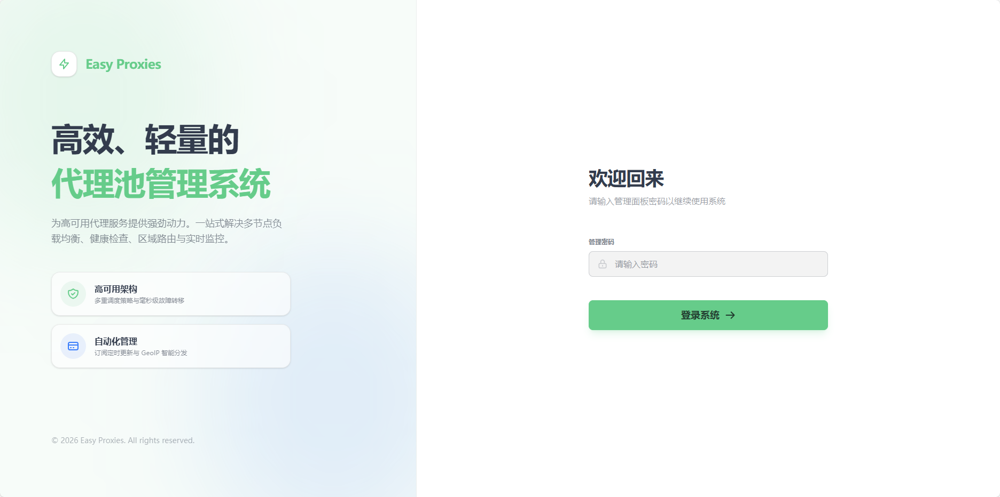
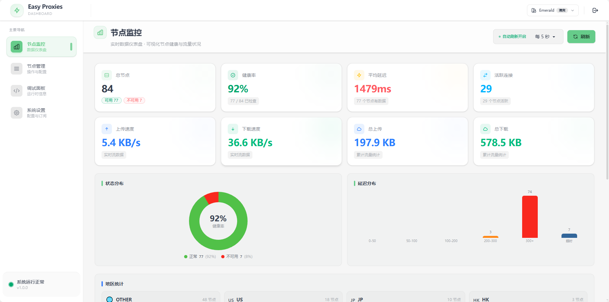
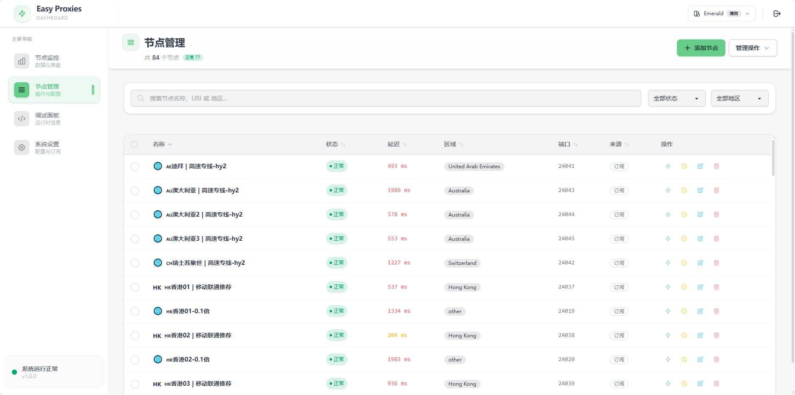
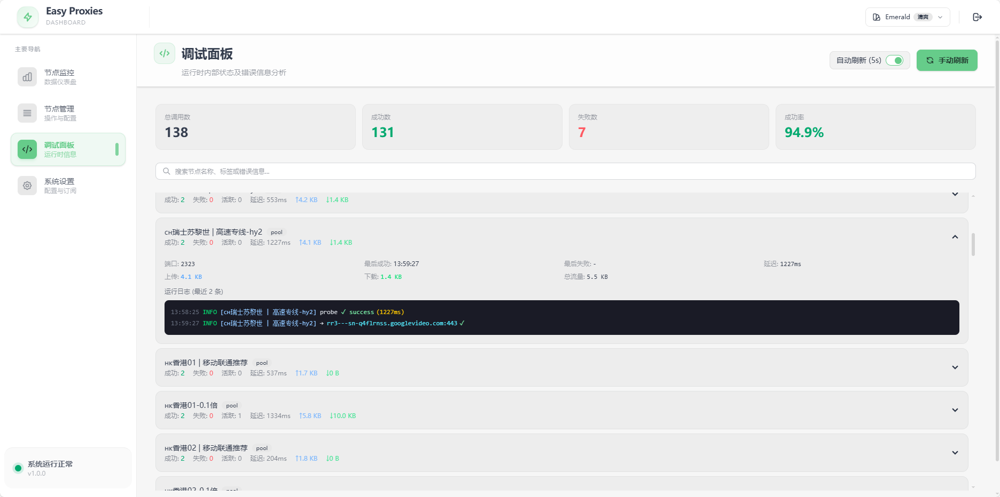
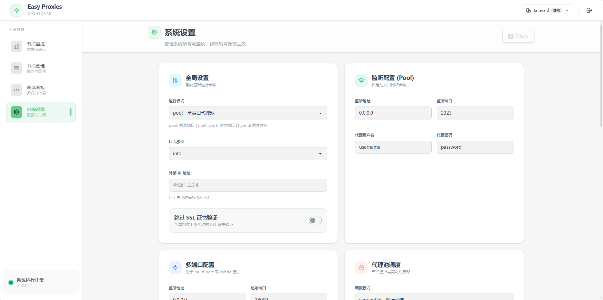
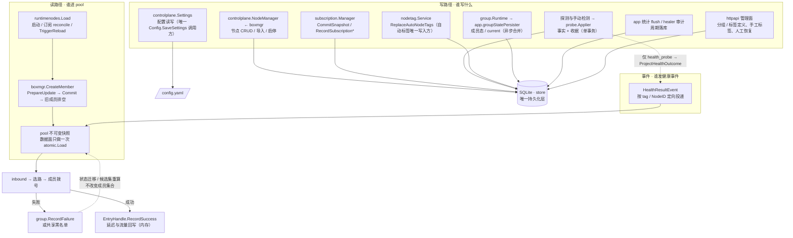

# EasyProxiesV2

EasyProxiesV2 是一个轻量级、高性能的代理池与订阅管理工具，底层基于 [sing-box](https://github.com/SagerNet/sing-box)。
项目内置现代化 Web 管理面板，支持节点健康检查、订阅刷新、流量监控与可视化管理。

> 二开声明：本项目基于 [jasonwong1991/easy_proxies](https://github.com/jasonwong1991/easy_proxies) 二次开发，V2 版本重点重构了前端与工程化流程。

## ❤️ 赞助木木

木木是独立开发者 / 开源爱好者，长期投入开源项目维护与迭代。
如果 EasyProxiesV2 对你有帮助，或者你认可我的工作，欢迎请我喝杯咖啡。你的支持是我持续创造的动力源泉 ⚡

- [赞助地址](https://mumuverse.space:1588/)

---

## ✨ 核心特性

- 现代化 Web UI（React + Vite + Tailwind + DaisyUI）
- 前后端一体化（前端静态资源已内嵌到 Go 二进制，单文件即可运行）
- 节点订阅与自动刷新
- 代理池智能调度与故障隔离
- GeoIP 分区路由（可选）
- SQLite 持久化存储运行状态与统计数据

## 🖼️ 项目预览







---

## 一键安装（Linux amd64 / arm64）

下载脚本后选择 Docker 或二进制部署。二进制模式自动注册 Linux 系统服务、启用开机自启并立即启动，需要 root 和正在运行的 systemd 或 OpenRC；Docker 模式需要事先安装 Docker。

```bash
curl -fL https://raw.githubusercontent.com/x0rz4/EasyProxiesV2/main/install.sh -o install.sh
# Docker 部署（当前用户需有 Docker 权限，默认使用 host 网络）
sudo bash install.sh --method docker
# 或：Release 二进制 + 系统服务（自动识别 systemd / OpenRC）
sudo bash install.sh --method binary
```

脚本默认显示中文，直接执行 `sudo bash install.sh` 即可安装到 `/opt/easy-proxies`。默认解析最新 Release，并将下载文件、配置模板和镜像固定到同一个版本。新配置会生成随机管理密码，保存在 `config.yaml`。已有配置及数据在更新时保留。

```bash
# 更新默认目录中的二进制，保留运行状态和自启设置
sudo bash install.sh --update
# 更新到指定版本；--action update 与 --update 等效
sudo bash install.sh --action update --version 2.2.14
# 更新现有 Docker 容器，保留运行状态与重启策略
sudo bash install.sh --method docker --update
# 首次使用 Docker，可指定版本与目录
sudo bash install.sh --method docker --version 2.1.0 --dir /opt/easy-proxies
# 不安装系统服务，适合普通用户或没有 systemd 的环境
bash install.sh --method binary --version 2.1.0 --dir "$HOME/easy-proxies" --no-start
```

二进制安装会验证 Release 提供的 SHA256。`--no-start` 在二进制模式只安装文件，在 Docker 模式只拉取镜像和准备配置。Docker 容器名为 `easy-proxies`，脚本只替换自身创建的容器。切换部署方式前，请先停止旧服务以免端口冲突；降级前备份数据。

更新使用 `--update`，要求已有对应安装；配置、节点文件和数据库保留。默认只重启原本运行的服务/容器，已停止的仍保持停止，自启设置不变。`--update --no-start` 仅准备新文件/镜像，需手动重启二进制或再次更新 Docker 才会加载新版本。

已安装的二进制可以单独注册服务，无需重新下载。下面的服务管理命令均适用于 systemd / OpenRC：

```bash
# 用现有 easy-proxies 和 config.yaml 注册服务、开启自启并启动
sudo bash install.sh --action register --dir /opt/easy-proxies
# 查询运行状态和开机自启状态
bash install.sh --action status
# 启动 / 停止 / 重启
sudo bash install.sh --action start
sudo bash install.sh --action stop
sudo bash install.sh --action restart
# 关闭 / 开启开机自启（不改变当前运行状态）
sudo bash install.sh --action disable
sudo bash install.sh --action enable
# 注销系统服务，保留二进制、配置和数据库
sudo bash install.sh --action unregister --dir /opt/easy-proxies
```

`--action register --no-start` 只注册并启用自启，不立即启动；安装/注册时添加 `--no-autostart` 则关闭开机自启。详细参数、OpenRC 依赖和失败排查见 [Linux 服务部署说明](docs/deployment.md)。

```bash
# 二进制服务日志 / Docker 日志
journalctl -u easy-proxies -f
docker logs -f easy-proxies
```

OpenRC 将进程输出写入系统日志，标签为 `easy-proxies`，可用系统的日志工具查询（例如 Alpine 的 `logread -e easy-proxies`）。

## 🚀 Release 二进制（Linux amd64 / arm64）

你不需要本地安装 Go 和 Node，直接下载发布产物即可使用。

### 1) 下载文件

从 GitHub Releases 下载这两个文件之一：

- Linux: `easy-proxies-linux-amd64`
- Linux arm64: `easy-proxies-linux-arm64`

并同时准备配置文件：

- 将仓库里的 `config.example.yaml` 复制为 `config.yaml`
- 按需修改端口、账号密码、订阅链接等

---

## 🐧 Linux 使用方法

### 1) 赋予执行权限
```bash
chmod +x ./easy-proxies-linux-amd64
```

### 2) 准备配置
```bash
cp ./config.example.yaml ./config.yaml
```

### 3) 启动程序
```bash
./easy-proxies-linux-amd64 --config ./config.yaml
```

### 4) 访问管理面板
默认访问地址：
- `http://127.0.0.1:9888`（本机）
- 或 `http://<服务器IP>:9888`
- 默认密码：`123456`
> 默认管理监听来自配置项 `management.listen`，默认值见 `config.example.yaml`。

---

## 💻 Windows EXE 使用方法

### 1) 准备文件
把下面两个文件放到同一目录：

- `easy-proxies-windows-amd64.exe`
- `config.yaml`（由 `config.example.yaml` 复制并修改）

### 2) 启动程序（PowerShell 或 CMD）
```powershell
.\easy-proxies-windows-amd64.exe --config .\config.yaml
```

### 3) 访问管理面板
浏览器打开：
- `http://127.0.0.1:9888`

---

## ⚙️ 配置说明（最小必读）

配置模板见 `config.example.yaml`，重点关注：

- `listener.enabled`: 是否创建共享 Pool 入口，默认 `false`
- `listener`: Pool 入口监听、协议与认证参数
- `multi_port.enabled`: 是否为每个节点创建独立入口，默认 `false`；节点较多时建议关闭
- `multi_port`: 每节点入口的监听、协议与默认认证参数
- `management.listen`: Web 管理面板地址（默认 `0.0.0.0:9888`）
- `management.password`: 面板登录密码（为空则不需要登录）
- `subscriptions` / `nodes_file` / `nodes`: 节点来源（三选一或混用）

---

## 🧪 从源码构建（开发者）

项目由 Go (1.24+) + Node (22+) 构成。

### 1) 构建前端
```bash
cd frontend
npm ci
npm run build
```

### 2) 构建后端
```bash
go mod download
go build -tags "with_utls with_quic with_grpc with_wireguard with_gvisor" -o easy-proxies ./cmd/easy_proxies
```

---

## 📦 Docker 部署

### 1) 准备配置和数据目录

```bash
mkdir -p easy-proxies/data
cd easy-proxies
curl -L https://raw.githubusercontent.com/x0rz4/EasyProxiesV2/main/config.example.yaml -o config.yaml
```

编辑 `config.yaml`，至少确认订阅地址、需要启用的入口开关及管理密码。默认两类基础代理入口均关闭，管理面板仍监听 `0.0.0.0:9888`。

### 2) 拉取镜像

```bash
docker pull ghcr.io/x0rz4/easyproxiesv2:latest
```

生产环境建议将 `latest` 替换为明确的版本标签，避免升级时意外引入不兼容变更。
镜像版本跟随 Release：`v2.1.0` 对应 `ghcr.io/x0rz4/easyproxiesv2:2.1.0`。稳定版本同时更新 `2.1`、`2` 和 `latest`；main 分支镜像使用 `main` / `sha-*` 标签，预发布版本使用自己的精确版本标签，均不覆盖稳定版本别名。
使用 Compose 时可通过 `EASY_PROXIES_VERSION=2.1.0 docker compose up -d --no-build` 指定已发布镜像版本。

### 3) 启动容器

Linux 推荐使用主机网络，可完整支持代理池、多端口及端口自动重分配：

```bash
docker run -d \
  --name easy-proxies \
  --restart unless-stopped \
  --network host \
  -v "$(pwd)/config.yaml:/etc/easy-proxies/config.yaml" \
  -v "$(pwd)/data:/etc/easy-proxies/data" \
  ghcr.io/x0rz4/easyproxiesv2:latest
```

如果不能使用主机网络，可以显式映射所需端口：

```bash
docker run -d \
  --name easy-proxies \
  --restart unless-stopped \
  -p 2323:2323 \
  -p 9888:9888 \
  -p 24000-24200:24000-24200 \
  -v "$(pwd)/config.yaml:/etc/easy-proxies/config.yaml" \
  -v "$(pwd)/data:/etc/easy-proxies/data" \
  ghcr.io/x0rz4/easyproxiesv2:latest
```

仅当 `listener.enabled: true` 时需映射 `2323`；仅当 `multi_port.enabled: true` 时需映射每节点端口范围，并与 `config.yaml` 保持一致。

### 4) 查看状态

```bash
docker logs -f easy-proxies
```

浏览器访问 `http://<服务器IP>:9888` 打开管理面板。如需共享 Pool 入口，先设置 `listener.enabled: true`，默认端口为 `2323`。

### 5) 更新镜像

```bash
docker pull ghcr.io/x0rz4/easyproxiesv2:latest
docker rm -f easy-proxies
```

然后重新执行上面的 `docker run` 命令。配置文件和运行数据保存在宿主机目录中，重建容器不会丢失。

### 从源码构建镜像

也可以克隆仓库后使用项目内的 `Dockerfile` 和 `docker-compose.yml` 本地构建：

```bash
docker compose up -d --build
```

## 🧭 架构速览：写路径与读路径

一句话：**只有 `store` 落库，只有 `runtimenodes.Load` 决定谁能进 pool；健康与剔除只认两类证据——`health_probe` 的探测结果和成员的真实拨号失败。**



- **写路径**：SQLite 的唯一入口是 `store`；`config.yaml` 由 `controlplane.Settings` 串行写入，与数据库写入互不替代。订阅刷新按语义窄写（`CommitSnapshot`、`RecordSubscriptionFailure`、`RecordSubscriptionNotModified`、`MarkSubscriptionAttempt`），不做“读整行再写回”。
- **健康事件**：`monitor` 联网前捕获身份快照 → `probe.Applier` 事务写入检测事实与探针收据 → `ProjectHealthOutcome` 更新运行态 → `HealthResultEvent` 定向投递到包含该节点的 pool。只有 `health_probe` 来源的自动测活会进入这条链；测速 / 解锁 / IP 质量等手动诊断共享同一事务，但**不发布健康事件**，也不参与剔除与恢复。`SnapshotOnly` 只是让 pool 重算候选集的屏障，不是新证据。人工“恢复成员”是独立管理命令（`ClearGroupNodeState` + `RestoreGroupMember`），同样会触发 `Recovered` 状态事件，但它不是测活收据。
- **进 pool**：成员集合只能由 `runtimenodes.Load` 决定（启动、订阅 reconcile、`TriggerReload` 共用）。`boxmgr` 以两阶段提交 `PrepareUpdate` → `Commit` 发布快照；`ReconcileSilent` 的状态迁移要等新快照可见后才 `NotifyEvents`。健康结果与流量失败只影响候选 / current，不增删成员。
- **读路径**：数据面每次连接只做一次 `atomic.Pointer.Load()` 取不可变快照，不持锁选路；控制面读运行态走 `monitor` 注册表，持久化列表直接读 `store`。

工程约定入口见 [AGENTS.md](AGENTS.md)（路由表）→ [docs/architecture.md](docs/architecture.md)（模块与依赖方向）、[docs/code-standards.md](docs/code-standards.md)（硬规则）、[LESSONS.md](LESSONS.md)（复盘错题本）；运行时契约与写路径审计见 [plane/README.md](plane/README.md)。

## 📁 目录结构简述

架构与大型代理池实施计划入口：[plane/README.md](plane/README.md)。其中分开维护当前行为规格、OpenSpec 风格变更提案/设计/任务/验收，以及运维手册和历史记录。

- `cmd/easy_proxies/`: Go 程序入口
- `frontend/`: 前端源码
- `internal/`: 后端核心模块
- `internal/httpapi/assets/`: 前端构建产物（会被 Go embed）
- `.github/workflows/build-and-release.yml`: 自动构建与发布流程

---

## 🙏 鸣谢

- 原作者 [jasonwong1991/easy_proxies](https://github.com/jasonwong1991/easy_proxies)
- 核心代理引擎 [sing-box](https://github.com/SagerNet/sing-box)
