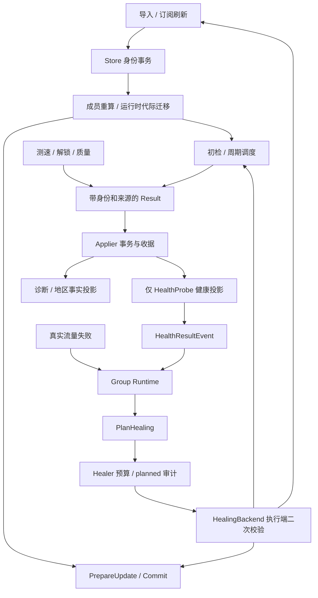

# 分层设计、事件与演进边界

状态：Proposed；[当前契约](../../specs/proxy-pool/spec.md) 是已核对的现状，本文件标为“拟新增”的内容尚未实现。

## 1. 领域分层和依赖

| 层 | 拥有的事实或决策 | 允许调用 | 禁止的越界 |
| --- | --- | --- | --- |
| L0 节点事实 | 身份 revision、出口地区、标签、订阅归属；共用成员规则 | Store 事务、纯规则引擎 | 从地址猜出口地区；由健康证据扩大规则候选 |
| L1 健康 | 探测安排、Result 应用、receipt、运行态健康投影 | 身份读取、Applier、受控事件发布 | 诊断直接改健康；旧代际结果清除新故障 |
| L2 分组 | 故障窗口/恢复、容量纯规划、调谐预算 | 已过滤候选、只读健康输入、HealingBackend 接口 | Healer 直接操作 SQLite、监听器或成员容器 |
| L3 数据面 | 出站生命周期、active 槽位、拨号和长连接 | builder、monitor 消费接口、group Runtime | 绕过 PrepareUpdate/Commit 改快照；standby 直接关闭连接 |
| L4 运营 | API/UI、策略校验、审计和解释 | Store / runtime 消费方接口 | 前端生成权威健康数或自行发明缺口语义 |
| L5 平台 | app 装配、发布、备份恢复；未来多实例协议 | 上述组件的明确端口 | 直接共享进程全局 map 或多机同时写 SQLite |

L0–L5 是责任视图，不是可互相 import 的线性栈。Go 依赖仍遵守 `app → boxmgr → monitor`，`monitor` 不 import `boxmgr/outbound/pool`；`group` 定义 HealingBackend，由 app/boxmgr 提供适配。`store` 负责事务，`nodefacts/nodeselect` 保持纯求值边界。已有 [HTTP 分层提案](../../monitor-server-domain-refactor.md) 可单独评估，不成为本项目的前置大重构。

图中 Result 有不同 kind；进入 Applier 不意味着任意诊断都能产生 HealthResultEvent。取消/超时/过期是不同结果：取消不能伪造节点不可用。

健康投影通知还包含 SnapshotOnly 模式，仅用于刷新快照，不能视为新的测活事件。队列改造或缓存失效通知必须保留这个区别。

## 2. 事件契约与当前实现映射

不先建立新事件总线。以下四类是逻辑契约，只有右列明确指出的类型已经存在。

| 逻辑契约 | 生产者 → 消费者、顺序与幂等 | 当前落点及缺口 |
| --- | --- | --- |
| TopologyChanged | 导入/订阅事务成功 → 身份变更清健康 → 成员 Reconcile/快照 → 新代际入初检；旧工作取消或拒绝应用 | `store` 身份/地区事务、`boxmgr.Manager` 和 `monitor.nodeRegistry` 的方法编排；**尚无同名 Go 类型或统一持久化事件** |
| HealthResult | 调度器联网前 Begin → `probe.Result{Origin:HealthProbe,Kind:Health}` → Applier/receipt → 投影 → `monitor.HealthResultEvent` | Observation 的 Token/Identity/Revision/ProbeID/StartedAt/CheckedAt 与 Health.Tag 负责身份和代际；Result 与投影事件不是同一 payload |
| GroupStateChanged | 真实失败/合法健康事件/显式恢复 → Runtime → 状态迁移；拓扑变更先静默迁移、发布快照，再 NotifyEvents | 现有 `group.GroupStateEvent`；节点级剔除/恢复会影响共节点组，不是每组私有健康事实 |
| HealAudit | Healer → `planned` 审计成功 → 执行端重读 → `succeeded/failed/deferred`；不足记 alert，禁执行记 dry_run | 现有 `group.HealAudit`、`store.GroupHealEvent`；5min 去重和保留期限制，尚无唯一 attempt_id / policy_revision 的全链路追踪 |

Topology 的后续 envelope SHOULD 包含 node IDs、身份 revision、原因、事务完成标识及去重键。具体字段、跨进程恢复和存储模型在阶段 1 的小提案中确定；不得把此建议写成现有 API。runtime generation、身份 revision 和筛选/政策版本分别建模。

## 3. 权威写入者与例外分类

单一写路径约束作用于每一种事实，不能把所有健康相关字段都强行迁入一种网络 Result：

- 测活事实走 Applier 和健康投影（HEALTH-001）；数据面真实失败进入现有 Runtime/黑名单故障入口。
- 初始注册、身份替换清空、持久化历史 provisional 恢复、人工显式恢复是生命周期或管理命令，不是新的测活成功。必须限定调用者并测试其权限、代际和事件影响。
- `EntryHandle` 中直接可用性更新、内存兼容写入口需逐项列出生产调用，不在文档里直接认证为安全；详见 [写路径审计](../../write-path-audit.md)。
- HTTP、unlock/nodedetect/quality、标签重算和 Healer 不得直接改恢复 streak；确需改动只能通过对应 Runtime 命令。

## 4. 自愈及安全默认

沿用 CAPACITY-001、HEAL-001/002。新组默认关闭容量或保持执行关闭。`target_size=0` 与 dry-run 是两种状态；后者允许规划和审计，不能笼统说“零副作用/零写入”。

只有新进入的动作才能由执行端再次检查；关闭执行当前不提供强制撤回在途网络请求的保证。阶段 1 增加关开关与并发执行的测试，阶段 3 在 UI 中解释“停止后续自愈动作，正常周期继续”，不承诺即时取消。planned 写入失败阻断执行；完成审计失败暴露未确定结果，不假装数据库事务能回滚外部动作。

保留原动作顺序和恢复阈值。`Healthy/Projected/Deficit` 在运营端分开显示；目标未填满、低于 min、初检未完成、证据过期、冷却、候选不足和预算延期分别解释。

## 5. 规模化方案与决策门槛

### 调度、队列和过载

当前自动 batch 并发为 32–128 再受节点数限制，显式并发、standalone 与其他检测入口仍需核对共享限额。共节点组测活取基础和适用组间隔中的最短值。初检、手动、周期轮次已有 actor 和 lease，不新建绕开去重的 worker 池。

`HealthEventHub` 当前每订阅使用无界 FIFO，慢消费者不阻塞 worker 的代价是内存可增长。未来先度量 queue_depth/oldest_age，再确定有界投递、背压或可恢复消费；**不能直接丢事件或仅保留最后值**，否则失败窗口和恢复计数会改变。若采用重放，必须提供顺序、去重、epoch、溢出恢复和退出行为测试。

### 预算、输入缓存和查询

先展示实际窗口消耗、延期原因、退避至何时和熔断状态，再配置化；新增参数需要配置默认、校验、热更新、持久化和 UI 一致性。文档中的指标名为拟议，不表示已有 metrics 接口。

`HealingInputs` 当前克隆配置并读取订阅、全量健康快照和组运行态；Healer.current 和执行端会反复调用。阶段 2 先测 CPU/分配/DB 次数，再考虑按组查询或摘要缓存。缓存必须随身份、地区、标签/规则、订阅、政策、运行代际、健康和时间新鲜度失效；每轮仍以显式 now 判定过期，执行端保留二次验证。优化前后应回放同一事件轨迹得到相同计划。

### 数据面、存储与恢复

继续复用 PrepareUpdate/Commit 和按 NodeID 的槽位保留，保留 nil previous 与显式空选择区别。WAL、1 writer/4 reader 和 busy_timeout 已实现；阶段 4 关注写入延迟、checkpoint、保留期任务和一致性备份。在线备份使用明确的 SQLite 一致性机制或停机备份，不能只复制运行中 `.db` 忽略 WAL。恢复后重新建立 runtime generation 和初检，不能把历史健康当新鲜证据。

## 拟新增规格增量

### ADDED Requirement SCALE-001：规模上界与过载可解释

系统 MUST 在约定场景记录健康队列与事件消费等待、完成率、超时和 deferred；过载不得无限积压且静默丢失故障/恢复语义。

#### Scenario: 慢消费者与全超时探测同时发生

- GIVEN 固定 N/M/S、已约定并发与网络总预算，并注入慢事件订阅者。
- WHEN 连续运行多个周期。
- THEN 有明确过载结果或有限排队上界，健康顺序与恢复计数不变，取消能释放 lease；达到门槛才可完成 M2。

### ADDED Requirement OPS-001：运维事实一致且动作可追溯

控制面 MUST 区分观测健康和规划健康，展示稳定缺口原因、冷却/预算和最近动作；保存策略遵守 CAPACITY-001 并可追踪政策变化。持久告警需定义持续窗口、去重和恢复条件。

#### Scenario: 持续缺口与策略关闭

- GIVEN 多个周期低于 min_healthy，UI 显示当前原因及政策。
- WHEN 操作员关闭执行并刷新视图。
- THEN 新的额外复检/订阅刷新不再启动，正常周期仍继续；在途动作与关闭后的新动作可区分，审计不宣称历史成功补齐了当前缺口。

### ADDED Requirement PLATFORM-001：多实例必须先定义权威和 fencing

仅在独立 RFC 通过并有冲突演练后才部署多实例；RFC MUST 定义权威存储、领导权/fencing、身份与代际、预算归属、故障切换和数据面连接边界。

#### Scenario: 两控制实例竞争同一组

- GIVEN 单机规格不再满足容量且进入多机设计阶段。
- WHEN 发生领导权切换或网络分区。
- THEN 旧实例不能继续提交有效成员动作，跨实例预算不会翻倍；在获得证据前不得将单机模块描述为 HA。
